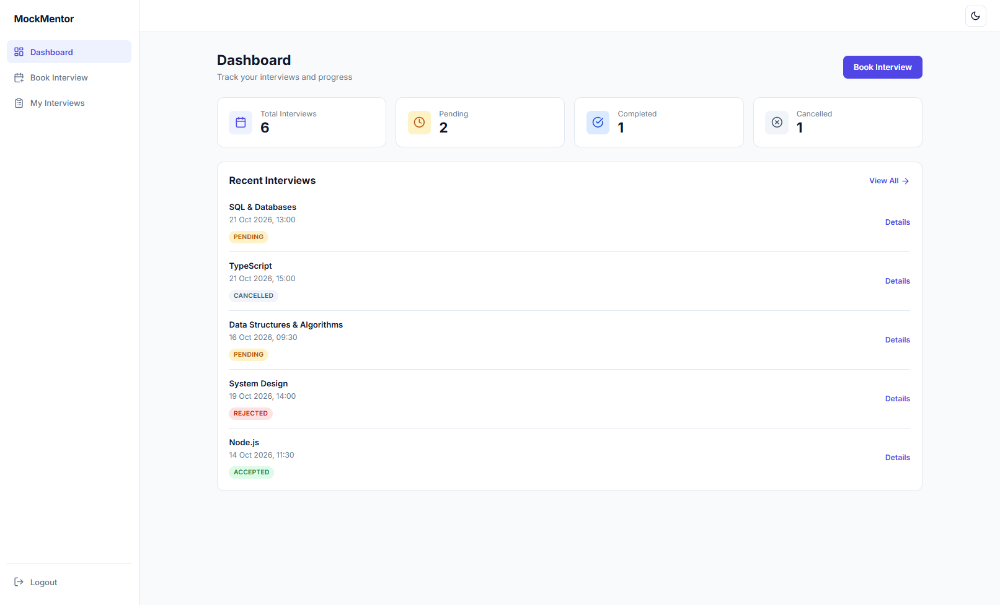
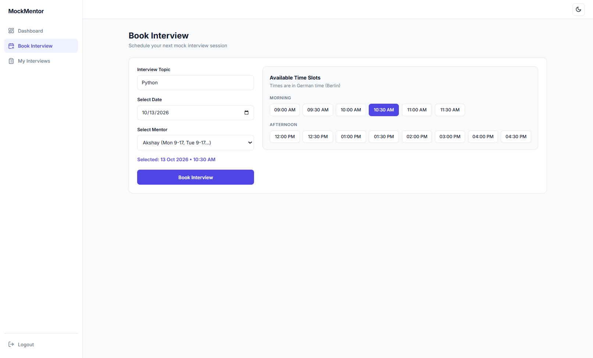
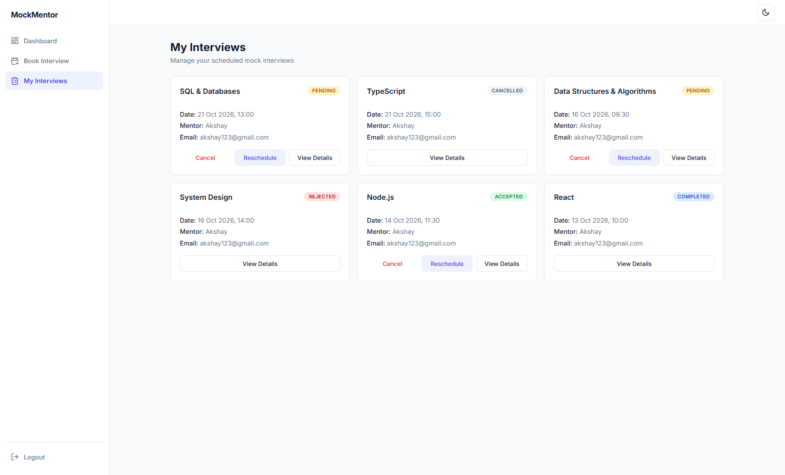
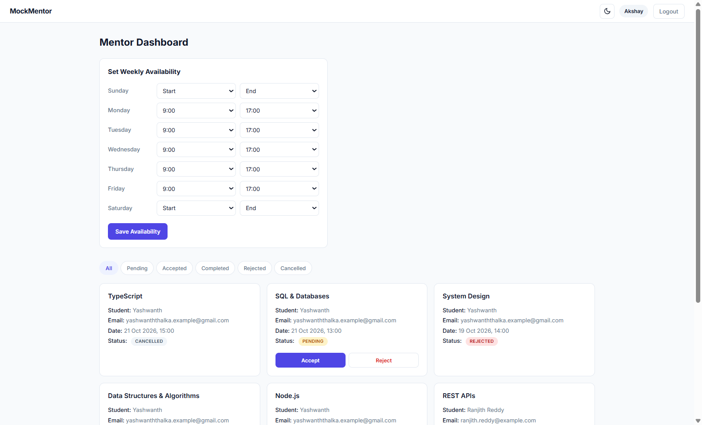
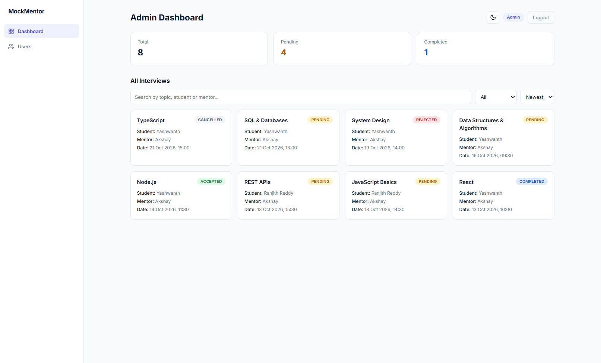
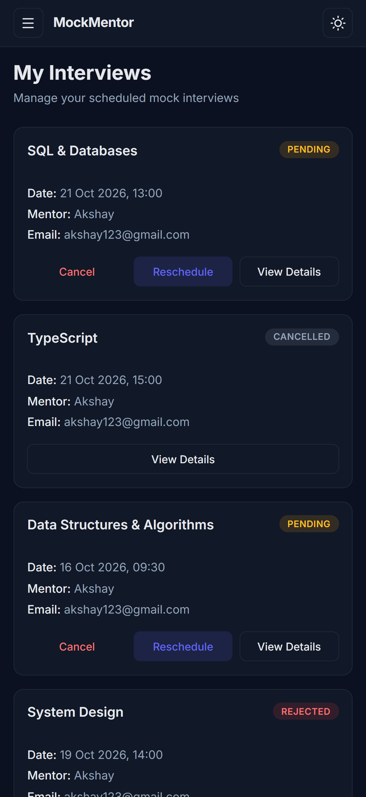

# MockMentor

[](https://github.com/Yashwanth2424/mockmentor/actions/workflows/ci.yml)

MockMentor is a web app where students can book mock interviews with mentors. I built it to practice full-stack development with Next.js, Prisma and PostgreSQL.

Live demo: https://mockmentor-flame.vercel.app

## What it does

There are three roles: student, mentor and admin.

**Students can:**

- book an interview by choosing a topic, a date, a mentor and a time slot
- see their interviews and the status (pending, accepted, rejected, completed, cancelled)
- reschedule or cancel an interview
- read the mentor's feedback after the interview
- get a confirmation email when they book

**Mentors can:**

- set the hours they are available for each day of the week
- accept or reject booking requests
- mark an interview as completed and give feedback (rating, strengths, things to improve)

**Admins can:**

- see all users, change a user between student and mentor, or delete them. Only the super admin can make someone an admin or remove an admin.
- see all interviews with the student and the mentor, and cancel one if needed
- see simple counts of total, pending and completed interviews

## Screenshots

**Student dashboard**



**Booking an interview**



**My interviews**



**Mentor dashboard**



**Admin dashboard**



**Phone view in dark mode**



More: [landing page](screenshots/landing.png), [login page](screenshots/login.png), [signup page](screenshots/signup.png), [admin users panel](screenshots/admin-users-panel.png)

## Tech stack

- Next.js 16 (App Router) with React and plain CSS
- Next.js API routes for the backend
- PostgreSQL on Neon, with Prisma as the ORM
- Login with JWT stored in an HTTP-only cookie
- SWR for fetching data on the client
- Zod for validating request data
- Resend for sending emails
- Deployed on Vercel

## How some things work

**Roles and access.** `src/proxy.js` checks the login cookie and the role before a page or API route is opened. Each API route also checks the user again, so the API is protected even without the proxy. For admin routes the server also reads the user's current role from the database, so a removed admin loses access right away and not only when the login token expires.

**No double booking.** A mentor or a student should never have two active interviews at the same time. The API first checks for a conflict to show a clear error message. But two requests can arrive at the same moment and both pass that check, so the real protection is in the database: two partial unique indexes on `(mentorId, date)` and `(userId, date)`, only for interviews that are PENDING or ACCEPTED. If two bookings for the same slot come in together, PostgreSQL accepts the first one and rejects the second, and the API returns a 409 error. Cancelled or rejected interviews do not block the slot. This is tested in [`tests/api/booking.test.mjs`](tests/api/booking.test.mjs): two students book the same slot at the same moment, and the test expects exactly one 201 and one 409.

Note: Prisma 5 cannot describe partial indexes in `schema.prisma`, so they only exist in the migration file. If a future `prisma migrate dev` tries to drop them, remove those `DROP INDEX` lines from the new migration.

**Status changes.** The allowed changes are listed in one place, [`src/lib/interviewStatus.js`](src/lib/interviewStatus.js): for example, only a PENDING interview can be accepted or rejected, and only an ACCEPTED one can be completed. Each change is one database update with the expected status inside the `where`, so the status check and the write happen together. If a student cancels while the mentor rejects at the same moment, only the first request changes the row, and the second gets a 409 ("This interview was already changed"). This is tested in [`tests/api/status.test.mjs`](tests/api/status.test.mjs). A mentor can complete an interview only after its start time.

**Other details:**

- passwords are hashed with bcrypt
- API responses always look like `{ success, data }` or `{ success, error }`
- simple rate limiting on login, signup and booking
- the SWR cache is cleared when a user logs out

## Demo accounts

You can try the app with these accounts:

| Role    | Email                         | Password |
| ------- | ----------------------------- | -------- |
| Student | yashwanth.student@example.com | 123456   |
| Mentor  | akshay.mentor@example.com     | 123456   |

The seed also creates a completed interview with feedback, so the student account shows a finished result right away, and one accepted interview from yesterday, so you can try "Complete" with the mentor account. If it was already completed, run `npx prisma db seed` again to get a new one.

The admin panel is not public. The admin features are listed above.

## Run it locally

You need Node.js 20.9 or newer and a PostgreSQL database (a free Neon account works). For emails you also need a Resend API key.

```bash
git clone https://github.com/Yashwanth2424/mockmentor.git
cd mockmentor
npm install

# copy the example env file and fill in your values
cp .env.example .env

# create the tables
npx prisma migrate deploy

# create the demo accounts and two demo interviews
npx prisma db seed

npm run dev
```

Then open http://localhost:3000.

To run the unit tests and the linter:

```bash
npm test
npm run lint
```

The API tests in `tests/api/` call the running app with real HTTP requests. They create test users, so run them against a test database, not production. They sign up more users per minute than the normal limit allows, so set `RATE_LIMIT_MULTIPLIER=100` in your `.env` first (CI does the same):

```bash
npm run build && npm start   # in one terminal
npm run test:api             # in another terminal
```

GitHub Actions runs everything on every push (see `.github/workflows/ci.yml`): format check, lint, unit tests, then it starts a PostgreSQL 16 database, runs the migrations and the seed, builds and starts the app, and runs the API tests against it.

The API tests check:

- double booking: two bookings for the same slot at the same moment give one 201 and one 409
- a cancelled slot can be booked again
- access control: no login gives 401, a student on an admin route gets 403, and a student cannot read another student's interview
- validation: a topic that is too short gives 400 with a clear message
- status changes: a student cancel and a mentor reject sent at the same moment give one 200 and one 409, and the final status matches the request that won
- a mentor cannot complete an interview before it has started (400)
- no `password` field in the interview and mentor responses

The pages themselves are checked by hand. Before a release I click through this list with the demo accounts:

1. Student: book an interview, then try to book the same mentor and time again (expect an error).
2. Student: reschedule the interview to another slot, then cancel it.
3. Student: book again. Mentor: accept it.
4. Mentor: try to complete a future interview (expect an error), then complete the past demo interview with feedback.
5. Student: open the completed interview and see the rating and feedback.
6. Mentor: change the weekly availability and check that the Book page shows the new slots.
7. Admin: filter interviews by status, cancel an interview, and change a user's role.
8. Log out and open `/dashboard` (expect the login page).

The `.env` file needs these values:

```env
DATABASE_URL=your_postgresql_connection_string
JWT_SECRET=a_random_string_of_at_least_32_characters
RESEND_API_KEY=your_resend_api_key
NEXT_PUBLIC_APP_URL=http://localhost:3000
```

## Project structure

```
src/
├── app/
│   ├── api/          # API routes
│   ├── dashboard/    # student pages
│   ├── mentor/       # mentor page
│   ├── admin/        # admin pages
│   ├── login/
│   └── signup/
├── components/       # header, sidebar, status badge, skeleton loaders, theme toggle
├── lib/
│   ├── prisma.js      # Prisma client
│   ├── auth.js        # password hashing and login checks
│   ├── adminAuth.js   # admin check
│   ├── jwt.js         # create and verify tokens
│   ├── validators.js  # Zod schemas
│   ├── time.js        # Berlin time helpers and date format
│   ├── format.js      # title case and HTML escaping
│   ├── fetcher.js     # shared data loader for SWR
│   ├── slots.js       # free time slots for booking and rescheduling
│   ├── interviewStatus.js       # allowed status changes and labels
│   ├── changeInterviewStatus.js # safe status update used by the API
│   ├── emailTemplates.js        # booking email
│   ├── apiResponse.js # helpers for API responses
│   ├── rateLimit.js   # rate limiting
│   ├── env.js         # checks the environment variables
│   └── email.js       # sending emails with Resend
└── proxy.js           # checks login and role before a route is opened
tests/                 # unit tests (Node's built-in test runner)
tests/api/             # API tests against the running app
```

## What I learned

- A check in the code is not enough to stop double bookings. Two requests can pass the check at the same time, so I added unique indexes in the database. An automated test sends two bookings at the same moment and checks that only one gets through.
- How Prisma migrations work, and why I test a migration on a copy of the database (a Neon branch) before running it on production.
- How login with JWT and HTTP-only cookies works, and why the API routes check the user again and do not only trust the proxy.
- To only send the data the page needs. At first some API responses included the password hash of users, and I changed them to return only id, name and email.
- My validation code used `error.errors`, which does not exist in Zod 4 (it is called `error.issues`). Because of that, every wrong input returned a server error instead of a clear message. Now I also test what happens with wrong input, not only with correct input.
- Time zones are tricky. The server runs in UTC but the app uses German time, and Germany changes between summer and winter time. I wrote small tests with Node's built-in test runner (`node:test`) to check the conversion, also on the days the clocks change.

## Known limitations

- The rate limiter keeps its counts in memory. On Vercel every server instance has its own memory, so the limit is not reliable there. A shared store like Redis would fix this.
- All times use German time (Europe/Berlin). There is no timezone setting per user yet.
- Emails are sent with Resend's test sender, so they only reach the email address of the Resend account.
- The API has automated tests for the main rules, but the pages (the React UI) are still tested by hand.
- The database is on Neon's free plan, which goes to sleep after a few minutes without use. The first request after that can take a few seconds, and Prisma prints a "connection closed" message in the console before it reconnects.

## Next steps

- [ ] Move the project to TypeScript
- [ ] Add tests for the pages
- [ ] Let students rate their mentors
- [ ] Add a calendar view for interviews

## Author

Thalka Yashwanth, M.Sc. Web Engineering student at TU Chemnitz, Germany

- LinkedIn: https://www.linkedin.com/in/thalka-yashwanth
- Portfolio: https://yashwanth2424.github.io/My-Portfolio/
